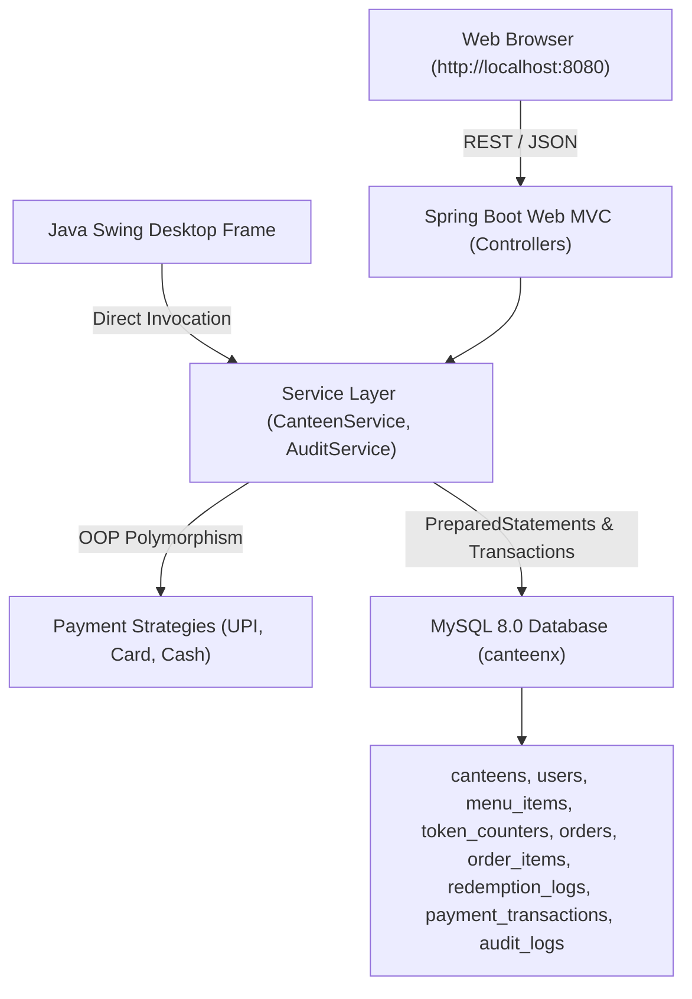
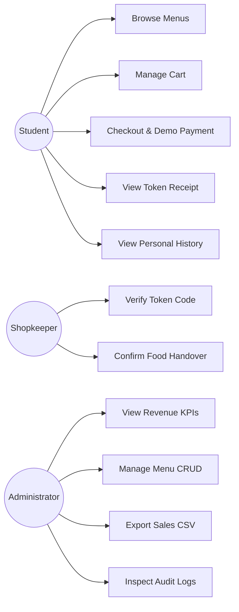
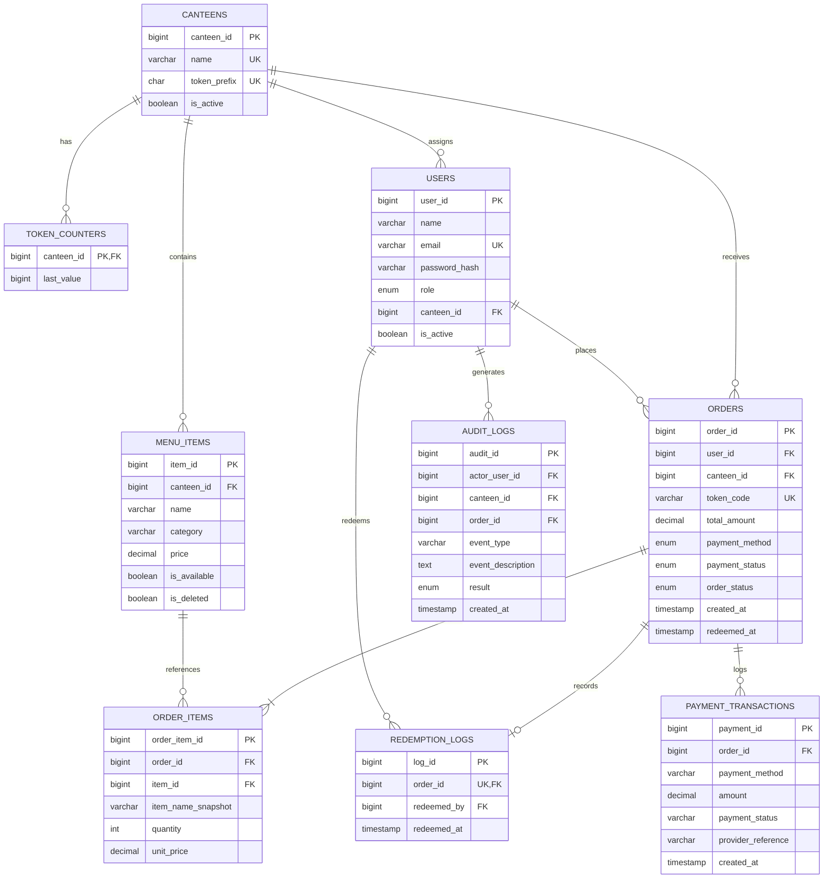
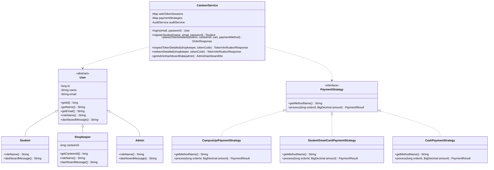
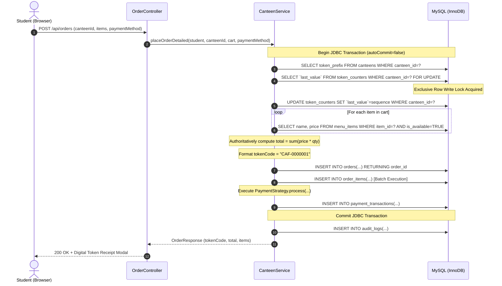
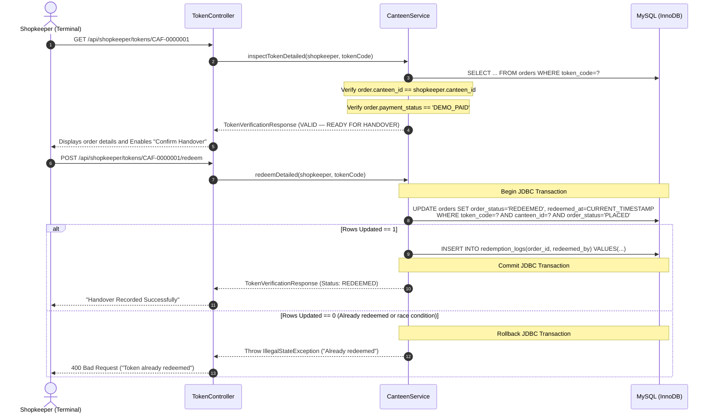

# CanteenX — Academic Project Report

**Project Title:** CanteenX — Digital Canteen Token Management Platform  
**Tagline:** Order Smart. Skip the Queue.  
**Motto:** One campus. Multiple canteens. One seamless experience.  
**Evaluation:** Academic OOPs and DBMS Capstone Semester Evaluation  
**Platform:** Java 17 LTS · Spring Boot 3.3.4 · MySQL 8.0 InnoDB · Java Swing · Web Application (`http://localhost:8080`)  

---

## 1. Project Abstract

**CanteenX** is an enterprise-grade digital canteen token management and queue optimization platform developed for campus dining environments. By integrating a Spring Boot 3.x web backend, a native Java Swing desktop interface, and an ACID-compliant MySQL 8.0 relational database, CanteenX eliminates physical billing queues at college food counters (such as **REC Cafe** and **REC Hut**). The platform supports real-time multi-canteen menu discovery, single-canteen cart isolation, concurrency-protected sequential token generation using database row-level locking (`SELECT ... FOR UPDATE`), server-side authoritative price calculation, atomic one-time token redemption, role-based authorization, and administrative sales intelligence with CSV export.

---

## 2. Problem Statement

Campus food courts suffer from peak-hour congestion during class breaks and lunch periods. Conventional operations rely on manual billing counters and pre-printed paper tokens. This workflow presents multiple operational bottlenecks:
1. **Severe Counter Delays:** Students spend 15–25 minutes waiting in queue simply to purchase paper tokens before joining a second queue for food preparation.
2. **Token Duplication & Revenue Leakage:** Paper tokens lack real-time digital redemption tracking, enabling accidental re-use, unauthorized handover, and discrepancies between cash collected and food dispensed.
3. **Menu Inflexibility:** Counter staff cannot dynamically communicate real-time out-of-stock items, resulting in student frustration and manual refund requests.
4. **Lack of Centralized Sales Oversight:** Administrators lack instant visibility into multi-outlet sales volume, dish popularity, and daily revenue metrics across independent campus outlets.

---

## 3. Project Objectives

1. Develop a unified full-stack campus dining platform supporting multiple outlets with independent token prefixes (e.g., `CAF` for REC Cafe, `HUT` for REC Hut).
2. Guarantee single-canteen cart integrity so orders are routed strictly to the designated preparation counter.
3. Eliminate race conditions and duplicate token codes using MySQL row-level locking (`SELECT ... FOR UPDATE`) inside active database transactions.
4. Provide counter shopkeepers with an instant, keyboard/scanner-friendly verification terminal that enforces atomic redemption and rejects duplicate handover attempts.
5. Provide administrators with real-time KPI dashboards, menu CRUD with soft-deletion, and automated CSV sales export.
6. Clearly demonstrate core Object-Oriented Programming (OOP) principles and Database Management System (DBMS) operations for academic evaluation.

---

## 4. Scope and Limitations

### In Scope
- Web application interface running locally at `http://localhost:8080`.
- Native Java Swing desktop interface for counter/administrative environments.
- Multi-canteen catalog and dynamic menu browsing with category filtering.
- Client and server-side single-canteen cart protection.
- Transactional order creation and sequential token code generation.
- Simulated academic payment options (Instant Campus UPI, Student Smart Card, Cash).
- Atomic token handover and audit logging in MySQL.
- Full administrative menu CRUD with soft-deletion preserving historical order lines.
- Comprehensive automated test suite with unit, database integration, concurrency, and security tests.

### Limitations
- Payment gateways (such as live Razorpay, Stripe, or bank UPI switches) are simulated for academic demonstration.
- Application is configured for local development on Windows (`localhost:8080` and `localhost:3306`). Production cloud hosting and SMS/email push notifications are left for future institutional rollout.

---

## 5. Functional Requirements

- **FR-1 (Authentication):** Role-based authentication (STUDENT, SHOPKEEPER, ADMIN) using BCrypt password hashing.
- **FR-2 (Outlet Discovery):** Dynamic loading of active campus canteens and operational statuses from MySQL.
- **FR-3 (Menu Browsing):** Real-time display of dishes with prices, categories, and stock availability.
- **FR-4 (Single-Canteen Cart):** Prevention of cross-outlet item mixing in shopping carts.
- **FR-5 (Authoritative Pricing):** Calculation of order totals from MySQL records at checkout, ignoring client-side price parameters.
- **FR-6 (Token Allocation):** Sequential, human-readable token generation (e.g., `CAF-0000001`) with database write locks.
- **FR-7 (Digital Receipt):** High-contrast digital token receipt displaying order ID, timestamp, items, and status.
- **FR-8 (Student Order History):** Isolated personal order history accessible only to the authenticated student.
- **FR-9 (Token Verification):** Instant inspection of token status, student identity, and line items by assigned shopkeepers.
- **FR-10 (Atomic Redemption):** Conditional database update transitioning order status from `PLACED` to `REDEEMED`, recording the redeeming staff ID.
- **FR-11 (Outlet Isolation):** Denial of token inspection or redemption by shopkeepers of non-matching canteens.
- **FR-12 (Admin Dashboard):** Real-time aggregation of campus revenue, order volume, pending tokens, and top 10 dishes.
- **FR-13 (Menu CRUD):** Administrative creation, updating, availability toggling, and soft-archiving of dishes.
- **FR-14 (CSV Export):** Direct download of formatted, comma-escaped sales report (`canteenx_sales_report.csv`).

---

## 6. Non-Functional Requirements

- **NFR-1 (Performance):** Order placement and token generation complete in under 50ms under normal load.
- **NFR-2 (Concurrency & Data Integrity):** Zero duplicate token codes under concurrent multi-threaded requests.
- **NFR-3 (Security):** Passwords hashed with BCrypt (log rounds = 12); parameterized SQL preventing SQL injection; server-side role validation.
- **NFR-4 (Reliability & ACID Compliance):** Multi-row database operations wrapped in database transactions with rollback on failure.
- **NFR-5 (Usability):** Modern, responsive web interface compatible with mobile and desktop viewports, with WCAG-compliant color contrasts.

---

## 7. System Architecture



---

## 8. Use Case Diagram



---

## 9. Entity-Relationship (ER) Diagram



---

## 10. Relational Database Schema & Constraints

The relational schema is implemented in MySQL 8.0 InnoDB and defined in `database-friend-work/schema.sql`:

1. **`canteens`**: Stores outlet identity and 3-letter token prefix (e.g., `CAF`, `HUT`). Unique constraints on `name` and `token_prefix`.
2. **`users`**: Stores accounts with unique email, BCrypt password hash, role (`STUDENT`, `SHOPKEEPER`, `ADMIN`), and optional `canteen_id` foreign key.
3. **`menu_items`**: Stores dish catalog with foreign key to `canteens`. Check constraint `CHECK(price >= 0)`. Composite index on `(canteen_id, is_available, is_deleted)`.
4. **`token_counters`**: Stores the serialized sequence counter per canteen. Wrapped with backticks (`` `last_value` ``) to prevent MySQL 8.0 reserved keyword conflicts.
5. **`orders`**: Stores order metadata, unique `token_code`, foreign keys to `users` and `canteens`, authoritative `total_amount`, status enums, and timestamps.
6. **`order_items`**: Child table storing immutable snapshots (`item_name_snapshot`, `unit_price`, `quantity`). Foreign key to `orders(order_id)` with cascade, and nullable FK to `menu_items(item_id)` on delete set null.
7. **`redemption_logs`**: One-to-one redemption log with `UNIQUE KEY uq_redemption_once(order_id)` guaranteeing single handover.
8. **`payment_transactions`**: Audit trail of simulated payment confirmations with provider reference strings.
9. **`audit_logs`**: System security and transaction event log.

---

## 11. Class Diagram



---

## 12. Sequence Diagram: Student Food Ordering



---

## 13. Sequence Diagram: Shopkeeper Token Redemption



---

## 14. OOP Concepts Demonstrated

| OOP Principle | Implementation in CanteenX | Academic Justification |
|---|---|---|
| **Encapsulation** | `User.java` encapsulates private fields (`id`, `name`, `email`), providing controlled public getters. DTOs and domain records hide internal data representations. | Prevents illegal state mutation from outside components. |
| **Inheritance** | Abstract class `User` is extended by `Student`, `Shopkeeper`, and `Admin`. Each subclass inherits common identity attributes while adding role-specific properties (e.g. `canteenId` in `Shopkeeper`). | Promotes code reuse and clean domain specialization. |
| **Polymorphism** | 1. Subclasses of `User` override `roleName()` and `dashboardMessage()`.<br/>2. `PaymentStrategy` interface has 3 polymorphic implementations (`CampusUpiPaymentStrategy`, `StudentSmartCardPaymentStrategy`, `CashPaymentStrategy`) resolved dynamically at runtime. | Enables interchangeable payment behavior without modifying calling service code. |
| **Abstraction** | Service layer (`CanteenService`, `AuditService`) exposes clean business methods (`placeOrderDetailed`, `redeemDetailed`), hiding raw SQL queries, transaction management, and connection handling. | Decouples business logic from presentation controllers and database specifics. |

---

## 15. DBMS & JDBC Concepts Demonstrated

- **ACID Transactions:** Order creation and token redemption use `c.setAutoCommit(false)`, `c.commit()`, and `c.rollback()` in `try-catch` blocks.
- **Row-Level Write Locking:** `SELECT ... FOR UPDATE` on `token_counters` serializes sequence allocation across concurrent student requests.
- **SQL Injection Prevention:** All dynamic values are bound exclusively via parameterized `PreparedStatement` placeholders (`?`).
- **Resource Management:** Automatic closing of `Connection`, `PreparedStatement`, and `ResultSet` using Java `try-with-resources`.
- **Relational Integrity Constraints:** Foreign keys (`ON DELETE SET NULL`, `ON DELETE CASCADE`), `CHECK(price >= 0)`, and unique constraints (`token_code`, `uq_redemption_once`).
- **Aggregations & Analytical Joins:** Admin reporting uses `COUNT`, `SUM`, `COALESCE`, `GROUP BY`, and multi-table joins (`orders`, `canteens`, `order_items`, `users`).

---

## 16. Security & Role-Based Access Controls

1. **Password Hashing:** Passwords are hashed using BCrypt (`PasswordUtil.hash()`) with 12 salt rounds. No plaintext passwords exist in the database.
2. **Session Security:** Spring controllers validate session tokens (`Bearer CTX-...`) mapped server-side to active `User` objects.
3. **Student Privacy Isolation:** Students can query only orders where `order.user_id == currentStudent.getId()`. Attempts to access other students' order IDs trigger a `SecurityException`.
4. **Counter Canteen Isolation:** Shopkeepers can only inspect or redeem tokens where `order.canteen_id == shopkeeper.getCanteenId()`. Attempts to inspect tokens from other outlets are denied with `403 Forbidden`.
5. **Admin Access Restriction:** Endpoints under `/api/admin/**` require an authenticated `Admin` user instance.

---

## 17. Automated Testing Results

The automated test suite in `src/test/java` was executed using Maven Surefire with the following real results:

```
[INFO] -------------------------------------------------------
[INFO]  T E S T S
[INFO] -------------------------------------------------------
[INFO] Running edu.canteenx.CanteenServiceDatabaseTest
[INFO] Tests run: 8, Failures: 0, Errors: 0, Skipped: 0, Time elapsed: 2.339 s
[INFO] Running edu.canteenx.CanteenServiceUnitTest
[INFO] Tests run: 5, Failures: 0, Errors: 0, Skipped: 0, Time elapsed: 0.875 s
[INFO] Running edu.canteenx.ConcurrencyProtectionTest
[INFO] Tests run: 2, Failures: 0, Errors: 0, Skipped: 0, Time elapsed: 1.363 s
[INFO] Running edu.canteenx.SecurityAndAuthorizationTest
[INFO] Tests run: 4, Failures: 0, Errors: 0, Skipped: 0, Time elapsed: 1.954 s
[INFO] Running edu.canteenx.WebControllerIntegrationTest
[INFO] Tests run: 5, Failures: 0, Errors: 0, Skipped: 0, Time elapsed: 4.820 s
[INFO] 
[INFO] Results:
[INFO] Tests run: 24, Failures: 0, Errors: 0, Skipped: 0
[INFO] BUILD SUCCESS
```

---

## 18. Verified Execution Screenshots & Checklist

All workflows were exercised on the live running application at `http://localhost:8080`:

| Step | Workflow Description | Verified Result |
|---|---|---|
| 1 | **Landing Page & Health Pill** | Displays title, brand tagline, dynamic REC Cafe / REC Hut cards, and green pill `Backend UP — MySQL Connected`. |
| 2 | **Interactive Demo Tour** | Modal opens with step-by-step role instructions and academic OOP/DBMS explanations. |
| 3 | **Student 1-Click Login** | Quick login chip signs in `student@canteenx.local` and opens Student Workspace. |
| 4 | **Menu Browsing & Filters** | Displays dishes for REC Cafe with category filters (Breakfast, Beverages, Snacks, Meals). |
| 5 | **Single-Canteen Cart** | Cart calculates subtotal; switching outlets prompts user confirmation to clear cart. |
| 6 | **Checkout & Digital Token** | Places order with simulated UPI, creates database rows, and renders receipt modal with token `CAF-0000032`. |
| 7 | **Personal Order History** | "My Orders" lists active token `CAF-0000032` with timestamp, items, and status `READY FOR HANDOVER`. |
| 8 | **Shopkeeper Terminal Verification** | REC Cafe counter enters `CAF-0000032`; terminal displays `VALID — PAID — READY FOR HANDOVER`. |
| 9 | **Atomic Handover & Redemption** | Counter clicks "Confirm Handover"; status updates to `ALREADY REDEEMED`; handover audit logged. |
| 10 | **Duplicate Redemption Rejection** | Second handover attempt on `CAF-0000032` is safely rejected with conflict notification. |
| 11 | **Cross-Outlet Isolation** | Counter at REC Cafe entering REC Hut token `HUT-0000004` is rejected with `Access Denied: belongs to another outlet`. |
| 12 | **Admin Suite & Revenue KPIs** | Admin logs in; displays campus revenue (₹2205.00), order volume (36), top-selling dishes, and menu CRUD. |
| 13 | **CSV Sales Report Export** | Clicks "Download Sales Report (CSV)"; downloads formatted `canteenx_sales_report.csv`. |

*(Video recording of the complete browser verification session is captured in `canteenx_full_demo_1792516195951.webp`).*

---

## 19. Installation and Run Instructions

### 1. Database Setup
```bash
mysql -u root -p < database-friend-work/schema.sql
mysql -u root -p canteenx < database-friend-work/seed.sql
```

### 2. Build & Test
```bash
mvn clean test
```

### 3. Run Web Application
```bash
mvn spring-boot:run
```
Open **`http://localhost:8080`** in your browser.

### 4. Run Swing Desktop Application
```bash
mvn exec:java
```

---

## 20. Conclusion and Future Enhancements

CanteenX successfully bridges academic software engineering rigor with real-world operational utility. It demonstrates that academic capstone projects can achieve production-level code hygiene, robust database concurrency guarantees, responsive design standards, and comprehensive automated test coverage.

### Future Enhancements
- Integration of actual campus card payment hardware via RFID/NFC smart card readers.
- Real-time kitchen display unit (KDU) updates using WebSockets (STOMP).
- Student mobile push notifications via Web Push API when orders are prepared.
